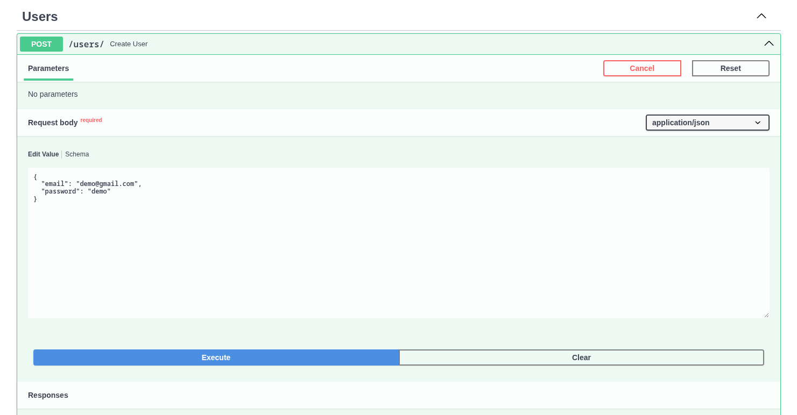
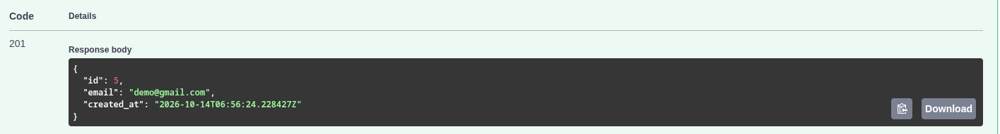
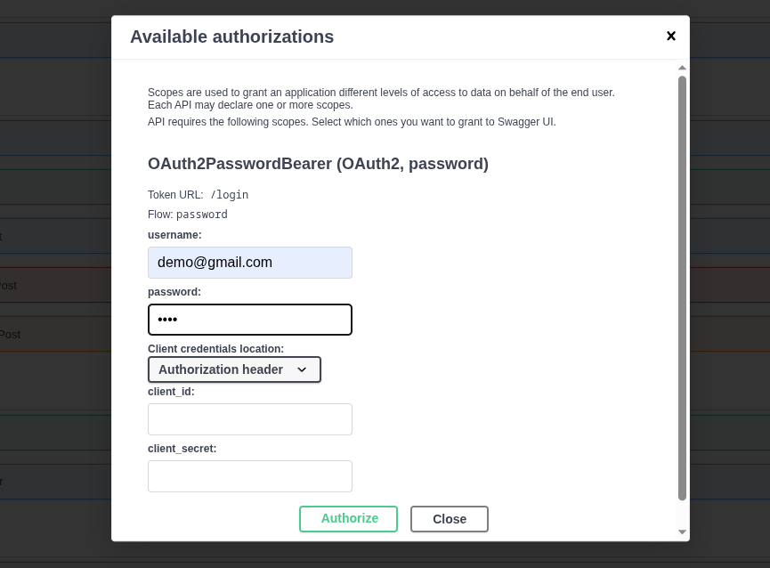
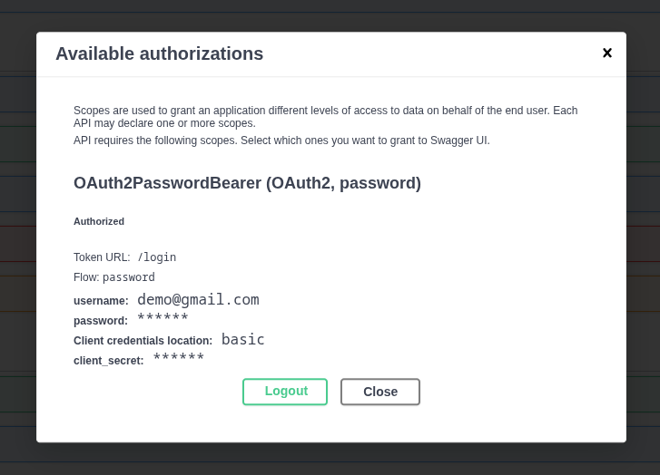
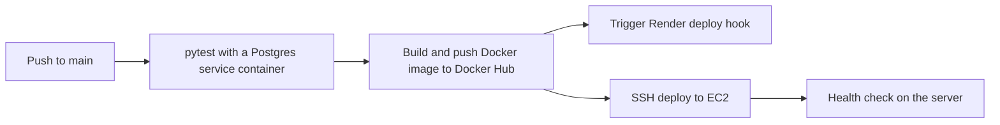

# README: myFastAPI

Oct 14, 2026 · [@bijesh-09](https://github.com/bijesh-09)

A posts-users-votes REST API built with FastAPI and PostgreSQL, tested with pytest and deployed through GitHub Actions to Render and AWS EC2.

## Overview

myFastAPI lets users register, log in with a JWT, create, update and delete their own posts, and vote on posts. It comes with Alembic migrations, a pytest suite, Docker images, and a CI/CD pipeline that tests, builds and deploys it.

I built it by following freeCodeCamp's free 19-hour FastAPI course, then pushed the deployment part much further than the course does (see the [`Deploy it yourself`](#deploy-it-yourself) section below).

**Check out my:**
- Deploy to your own EC2: [`Guide: Deploy myFastAPI to your own EC2 with GitHub Actions`](docs/Guide.md#guide-deploy-myfastapi-to-your-own-ec2-with-github-actions)
- The story behind it: [`Blog: From a 19-hour FastAPI course to AWS CI/CD`](docs/Blog.md#blog-from-a-19-hour-fastapi-course-to-aws-cicd)

**Live demo**

- Swagger UI: https://my-fast-api-latest.onrender.com/docs
- Root route (returns `Hello World`): https://my-fast-api-latest.onrender.com/
- (Deployed on AWS) : https://bijeshkaranjit.me/ (Don't visit this since I have deleted the AWS EC2 instance and released my Elastic IP for saving up my costs)

**Before you click**

- The demo runs on Render's free tier, so the first request after a quiet period takes about 50 seconds (cold start). Please wait for it.
- The demo may be down or reset at any time. Don't enter real credentials or personal data.
- Render's free tier hosts `postgres` instace 24/7 for one month, so the web service will only work till `2026 Nov 11`

**Built with:** FastAPI, Pydantic, SQLAlchemy 1.4, Alembic, PostgreSQL, JWT, pytest, Docker and Docker Compose, GitHub Actions, Render, AWS EC2, nginx.

**Contents:** 
- [Try the API](#try-the-api)
- [Project structure](#project-structure)
- [CI/CD pipeline](#cicd-pipeline)
- [Run and test locally](#run-and-test-locally)
- [Deploy it yourself](#deploy-it-yourself)
- [What I learned](#what-i-learned)
- [Credits](#credits)

## Try the API

Only `/posts` and `/vote` need a login. `/users` (register), `/login` and `/` are public.


1. Open the Swagger UI at `/docs` and wait out the cold start if needed.

2. Expand `POST /users`, click **Try it out**, and create a user with an email and a password.





3. Click the **Authorize** button (the lock icon) at the top right in any one of the `/posts` or `/vote`.


4. Enter the email as `username` and the password you just created. Leave `client_id` and `client_secret` empty and keep **Client credentials location** on its default. Click **Authorize**.





5. Swagger calls `/login` for you and stores the token, so the lock closes. Now try any `/posts` or `/vote` route, for example `POST /posts/`. You don't need to repeat this for each route.

**Using curl or Postman instead.** Call `POST /login` with form data (`username` and `password`), copy the `access_token` from the response, and send it as `Authorization: Bearer <token>` on later requests.

**About tokens.** A token expires 30 minutes after login (set by `ACCESS_TOKEN_EXPIRE_MINUTES`). Logging out in Swagger only clears the page: the token itself still works until it expires, because JWTs are stateless.

Every route shows example request bodies in Swagger, so feel free to try them all.

## Project structure

```text
myFastAPI/
├── app/
│   ├── main.py             # FastAPI app and router registration
│   ├── database.py         # SQLAlchemy engine, session factory, get_db
│   ├── models.py           # ORM models: User, Post, Vote
│   ├── pydantic_schemas.py # request and response schemas
│   ├── oauth2.py           # JWT creation, verification, get_current_user
│   ├── utils.py            # password hashing helpers
│   ├── myenv.py            # settings loaded from environment variables
│   ├── calculations.py     # small functions used for the pytest basics demo
│   ├── routers/            # auth.py, user.py, post.py, vote.py
│   └── .env                # your secrets (never committed)
├── alembic/                # migrations: env.py and versions/
├── alembic.ini
├── tests/
│   ├── conftest.py         # test DB, client and auth fixtures
│   ├── test_users.py
│   ├── test_posts.py
│   ├── test_votes.py
│   └── my_test.py          # pytest basics demo (fixtures, parametrize, exceptions)
├── .github/workflows/
│   └── build-deploy.yml    # CI/CD: test, build, push, deploy
├── Dockerfile
├── docker-compose-dev.yml  # local development stack
├── docker-compose-prod.yml # production stack (used on EC2)
├── gunicorn.service.example # systemd unit for the manual EC2 setup
├── .env.example
└── requirements.txt
```

## CI/CD pipeline

Every push to `main` runs the tests first, and nothing is deployed unless they pass. The workflow lives in `.github/workflows/build-deploy.yml`.



- **build job** (uses the `testing` environment): installs dependencies, runs pytest against a throwaway Postgres container, then builds the image and pushes it to Docker Hub as `latest` and as the commit SHA, using the GitHub Actions layer cache.
- **Render deploy job** (uses the `prod` environment): calls Render's deploy hook so Render pulls the new image.
- **EC2 deploy job** (uses the `prod` environment): SSHes into your server, pulls the repo and image, recreates the app container, and checks that the app answers. To set it up on your own fork, follow Guide: Deploy myFastAPI to your own EC2 with GitHub Actions.

The two deploy jobs both wait for `build` and then run in parallel.

## Run and test locally

You need Python and a running PostgreSQL (or use the dev compose file).

```bash
git clone https://github.com/bijesh-09/myFastAPI.git
cd myFastAPI
python -m venv venv
source venv/bin/activate
pip install -r requirements.txt
cp .env.example app/.env     # then edit the values
```

Create the databases, apply the migrations, and start the server:

```bash
createdb fastapi             # use the DATABASE_NAME from your .env
createdb fastapi_test        # the test database, see the note below
alembic upgrade head
uvicorn app.main:app --reload
```

Or start the whole local stack with Docker: `docker compose -f docker-compose-dev.yml up`.

**Run the tests**

```bash
pytest -v
```

**The `_test` rule.** The tests connect to a database named `<DATABASE_NAME>_test`. If your `.env` says `DATABASE_NAME=fastapi`, the test database must be called `fastapi_test`. Before every test, `conftest.py` runs Alembic `downgrade base` and `upgrade head` on that database, so it is wiped each time. Never point it at a database you care about.

**What the tests cover.** For the user, post and vote routes: the happy path, authentication (missing, garbage and unknown-user tokens), not found, schema validation, ownership checks, and boundaries. If you find a bug, please open an issue, or add a test and send a pull request.

## Deploy it yourself

I tried five ways to deploy this app, from one-click to fully hand-built. Pick the one that fits. If you want to deploy through other hosting services other than `Render` or `EC2` then make sure to build `CI/CD` yourself

### Render 
( If you only want to deploy via Render, you can skip the `AWS EC2` part. )

Create a web service and a Postgres instance on render.com, set the environment variables, and you are done. I deployed the web service two ways:

1. **Sync with the GitHub repo.** Render builds from source. Set auto-deploy to "On commit", or to "After CI checks pass" so Render waits for the GitHub Actions run to go green.
2. **Sync with a Docker Hub image.** Create the service from an existing image. CI builds and pushes the image after the tests pass, then calls the service's **Deploy Hook** (Settings > Deploy Hook in Render). Store the hook URL as the `RENDER_DEPLOY_HOOK_URL` secret in the `prod` environment and turn auto-deploy off for that service, so it doesn't deploy twice.

Render's free Postgres instances expire after about 30 days, so check Render's current pricing page before relying on one.

### AWS EC2

| Way | What it involves | Effort |
| --- | --- | --- |
| Manual setup | SSH in, clone the repo, install PostgreSQL, edit `pg_hba.conf` and `postgresql.conf`, and create systemd services for Postgres and gunicorn (see `gunicorn.service.example`). Pull by hand on every change. | High |
| Docker Compose by hand | Pull the repo and the Docker Hub image on the server, run `docker-compose-prod.yml`, and add a systemd unit so it starts on boot. | Medium |
| Docker Compose through CI/CD | A GitHub Actions job does the pull, restart and health check for you on every push. | One-time setup, then none |

To deploy your own fork with the CI/CD route, follow Guide: Deploy myFastAPI to your own EC2 with GitHub Actions.

Docker Hub tip: create a personal access token with **Read & Write** permission, or the runner can't push the image. You can name your Docker Hub repository anything you like, but update the image name in the workflow and in `docker-compose-prod.yml` to match, and keep the `_test` database rule in mind.

## What I learned

Everything here comes from the [19-hour freeCodeCamp course](https://youtu.be/0sOvCWFmrtA). Each link opens the video at the start of that topic.

| Theme | What I practiced | Start |
| --- | --- | --- |
| FastAPI basics | Virtual environments, path operations, Pydantic validation, CRUD, status codes, automatic docs | [0:36:21](https://youtu.be/0sOvCWFmrtA?t=2181) |
| Databases and SQL | PostgreSQL, tables, queries, filters, LIKE, ordering, LIMIT and OFFSET | [2:24:11](https://youtu.be/0sOvCWFmrtA?t=8651) |
| ORM | SQLAlchemy models, the full CRUD set, Pydantic vs ORM models, response models | [4:31:18](https://youtu.be/0sOvCWFmrtA?t=16278) |
| Users and routers | User registration, password hashing, FastAPI routers | [5:50:08](https://youtu.be/0sOvCWFmrtA?t=21008) |
| Authentication | JWT tokens, login, OAuth2 password form, protected routes | [6:32:49](https://youtu.be/0sOvCWFmrtA?t=23569) |
| Relationships and votes | Foreign keys, owner-only edits, query parameters, env variables, vote table, SQL joins | [7:50:33](https://youtu.be/0sOvCWFmrtA?t=28233) |
| Migrations | Alembic setup and workflow | [10:30:18](https://youtu.be/0sOvCWFmrtA?t=37818) |
| Deployment | Heroku, an Ubuntu VM, gunicorn, systemd, nginx, SSL | [11:34:39](https://youtu.be/0sOvCWFmrtA?t=41679) |
| Docker | Dockerfile, Compose, Postgres container, Docker Hub | [13:26:09](https://youtu.be/0sOvCWFmrtA?t=48369) |
| Testing | pytest, fixtures, parametrize, TestClient, test database, conftest | [14:14:51](https://youtu.be/0sOvCWFmrtA?t=51291) |
| CI/CD | GitHub Actions, secrets, Docker builds, deploy to a VM | [17:34:15](https://youtu.be/0sOvCWFmrtA?t=63255) |

**What I did differently.** The course deploys to Heroku and a DigitalOcean VM. I deployed to Render and AWS EC2 instead, and wired the EC2 deploy into CI/CD with Docker Compose.

**On testing.** Writing tests turned out to be as hard as writing the API, because you have to think through every scenario. It took me more than 8 hours to test all the routes, but it was fun and it found real bugs.

**Before you start the course.**

- Learn Linux and Docker fundamentals first. The course jumps straight into using them to build the project.
- Learn database theory and practice PostgreSQL by hand. The course explains joins and other concepts, but only the ones this project needs, so a solid base makes the dots connect.

## Credits

This project follows the free, comprehensive [FastAPI course on YouTube](https://youtu.be/0sOvCWFmrtA) published by freeCodeCamp and taught by Sanjeev Thiyagarajan. A huge thank you to both for putting a 19-hour course out for free.

- Live demo: [https://my-fast-api-latest.onrender.com/docs]
- Deploy to your own EC2: [Guide: Deploy myFastAPI to your own EC2 with GitHub Actions](docs/Guide.md#guide-deploy-myfastapi-to-your-own-ec2-with-github-actions)
- The story behind it: [Blog: From a 19-hour FastAPI course to AWS CI/CD](docs/Blog.md#blog-from-a-19-hour-fastapi-course-to-aws-cicd)
